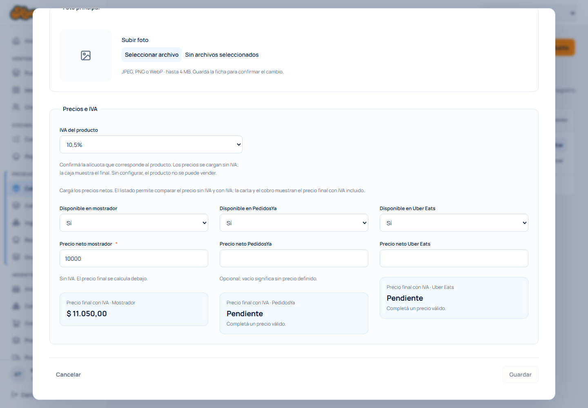

# IVA por producto y comisión por medio de pago

Implementación y verificación del 19/10/2026. La emisión de comprobantes con ARCA queda para la siguiente etapa.

## Configuración y comportamiento

- En **Catálogo y precios → Editar producto → Producto → Precios e IVA** se configura la alícuota. Los precios se cargan netos, con vista previa final por canal. El listado compara **Sin IVA** y **Con IVA** en cada canal, con el final destacado, tanto en escritorio como en celular. La carta y el cobro muestran el precio final con IVA incluido.
- Los precios y adicionales existentes se conservaron como netos. No se multiplicaron ni reescribieron los importes del catálogo. Guardar varias veces no acumula IVA.
- Un producto sin alícuota aparece con **IVA pendiente** y no puede venderse. El servidor también lo valida. 0% es una elección explícita y distinta de un dato pendiente; no clasifica por sí solo una operación como exenta o no gravada.
- Los adicionales de modificadores y combos se cargan sin IVA. El precio neto completo recibe IVA una sola vez, con redondeo a centavos. Los componentes incluidos de un combo no vuelven a sumar sus precios individuales.
- En **Configuración → Medios de pago** se carga **Comisión total (%)**. Representa el costo porcentual total estimado del proveedor sobre el importe efectivamente cobrado por ese medio. Vacío significa desconocido; 0% indica costo cero explícito.
- La comisión no aumenta el total que paga el cliente ni reduce el importe registrado como pagado. El encargado puede consultar la comisión y el neto estimado de cada cobro en el detalle de la venta. Estos datos no se envían a empleados por la API de ventas.
- Cada nueva venta conserva su alícuota y desglose; cada cobro conserva su comisión vigente. Cambiar la configuración después no altera ventas anteriores. Los registros históricos sin estos datos siguen pendientes, sin clasificación retrospectiva.
- Una devolución conserva la comisión original y no presume que el proveedor la reintegra. La comisión y el neto estimado de la devolución quedan sin determinar.
- Caja valida la revisión del producto para detectar cambios de IVA mientras se arma el pedido, incluso si el precio final coincide por redondeo. La configuración pública de productos conserva sus dos lecturas de datos.

## Migración de desarrollo

Se aplicó `0021_product_vat_payment_fees` mediante `scripts/apply-pricing.ts --apply`, dentro de la autorización previa para migraciones de desarrollo. La ejecución y una comprobación posterior en solo lectura confirmaron:

- Historial de migraciones verificado y migración 0021 aplicada.
- Contenido anterior conservado mediante huellas de las 12 tablas verificadas, excluyendo únicamente las columnas nuevas.
- **20 productos sin alícuota** y **4 medios de pago sin comisión**: requieren configuración con sus valores reales. No se asignó ninguna tasa por suposición.
- No se crearon ventas de prueba en la base de desarrollo. Las pruebas de venta usaron bases descartables.
- El verificador de la migración 0020 también reconoce correctamente el historial posterior a 0021.

La migración agrega columnas y restricciones. No cambia precios netos ni rellena condiciones fiscales o comisiones desconocidas. El script funciona en modo de solo lectura por defecto; exige `--apply` para aplicar cambios.

## Verificaciones

- **55 pruebas en 10 archivos aprobadas**: cálculo monetario, catálogo, configuración pública, ventas, combos, migración, permisos, caché y componentes táctiles. Registro: `.local/touch-pos/vat-tests-final.log`.
- **4 recorridos de navegador aprobados**, con Chrome y entrada táctil: configuración de IVA/comisión y venta, selección de combo con modificadores, precarga/edición sin solicitudes repetidas y caja táctil con recuperación idempotente. Registro: `.local/touch-pos/vat-e2e-final.log`.
- Repetición aprobada del recorrido de IVA/comisiones para capturar y revisar visualmente la vista previa. Registro: `.local/touch-pos/vat-e2e-preview.log`.
- Comparación de precios en listado verificada en navegador: $10.000 sin IVA y $12.100 con IVA al 21%, conservando $10.000 netos después de cambiar a 10,5%. Se verificaron escritorio (1440 px) y celular (390 px), con capturas revisadas en `docs/previews/product-prices-vat-desktop.png` y `docs/previews/product-prices-vat-mobile.png`. Registro: `.local/touch-pos/vat-list-e2e.log`. Tipos, lint y formato del ajuste aprobados; registro de tipos en `.local/touch-pos/vat-list-types.log`.
- Revisión independiente de precios, redondeos, cambios de alícuota, historial y comisiones sin defectos encontrados. Sus dos escenarios adicionales se agregaron a las pruebas: cambio de IVA que conserva el mismo precio final y combo con adicionales de centavos.
- Lint de los archivos modificados aprobado. Registros: `.local/touch-pos/vat-lint.log` y `.local/touch-pos/vat-lint-final.log`.
- Comprobación de tipos aprobada (`pnpm typecheck`), después de corregir el tipado de los resultados de la prueba de migración. Esta prueba volvió a pasar. Registros: `.local/touch-pos/vat-types-final.log` y `.local/touch-pos/vat-migration-test-final.log`.
- `git diff --check` sin errores; archivos de configuración temporal del navegador restaurados al contenido previo.

Los casos cubren $10.000 netos a 21% → $12.100 finales; 10,5% → $11.050; IVA 0% explícito; IVA pendiente; límites de importes; redondeo una sola vez; pago dividido con distintas comisiones; reintentos; cambio posterior de tasas; anulación y privacidad de comisiones. En navegador, un cobro de $11.050 al 3% conserva $331,50 de comisión y $10.718,50 de neto estimado, manteniendo $11.050 como total pagado.

## Alcance pendiente

El modelo actual estima una comisión porcentual total; no concilia liquidaciones ni contempla importes fijos, condiciones de cuotas o retenciones. Cada combo utiliza su propia alícuota configurada; una factura que requiera distribuir tratamientos fiscales distintos entre sus componentes necesita una regla adicional antes de conectar ARCA.

No se emitieron comprobantes, no se modificó `.env` y no se hicieron commits ni push. Las modificaciones locales previas se conservaron.

## Rentabilidad por medio de pago en Costeo

En **Catálogo y precios → Editar producto → Costeo** se agregó una comparación interna para cada medio activo: precio sin IVA, costo del producto, comisión y margen estimado. Se puede elegir Mostrador, PedidosYa o Uber Eats. El precio final al cliente se muestra como referencia y no cambia al elegir el medio de pago.

La comparación usa los precios guardados, la receta publicada y sus opciones predeterminadas. Conserva por separado el costo de ingredientes, mermas y descartables, y la comisión total del proveedor sobre el precio final con IVA. El margen se obtiene del precio sin IVA menos ambos costos, antes de sueldos, alquiler y otros gastos. Se mantienen seis decimales en costos hasta redondear el margen final; las pérdidas se muestran con signo negativo.

Para combos se elige un producto disponible de cada grupo, partiendo de la primera opción disponible. Se suman sus costos y adicionales netos según la cantidad incluida. No se suman sus precios individuales de venta ni se vuelve a aplicar el IVA de los componentes. El detalle identifica los componentes y sus opciones predeterminadas como configuración de referencia.

Los costos siguen correspondiendo a la sucursal del header, con referencias cuando no hay stock. IVA, costos, recargos y comisiones desconocidos quedan pendientes; 0% explícito sí permite calcular. Los datos financieros se consultan únicamente con permisos de encargado o administrador, incluso si un empleado tiene acceso al catálogo compartido. El servidor rechaza la consulta financiera de un empleado.

La consulta se conserva entre pestañas y cambios de canal/componentes, sin nuevas solicitudes por cada interacción. Se renueva al publicar la receta/combo, cambiar la revisión del producto o pulsar **Actualizar estimación**. Para venta directa y combos, el costo y la rentabilidad comparten la misma consulta y valoración de inventario.

Verificación de esta ampliación: **39 pruebas aprobadas en 6 archivos**, incluidas las diferencias entre sucursales, recargos predeterminados, cantidades de combos, márgenes negativos, IVA/comisiones pendientes y permisos. Tipos y lint aprobados. Registros: `.local/touch-pos/profitability-tests.log`, `.local/touch-pos/profitability-types-final.log` y `.local/touch-pos/profitability-lint-final.log`. No requiere nuevas migraciones.

Recorridos de navegador aprobados: selección/edición de combos y flujo real de IVA, Costeo y cobro. La prueba de rentabilidad verificó $10.000 netos, costo de $1.200, IVA del 10,5%, comisión del 3% ($331,50) y margen de $8.468,50; cambio de canal y pestañas con una sola consulta financiera; rechazo HTTP 401 sin sesión; ausencia de comisiones en el diálogo de cobro y conservación de $11.050 como total pagado. La prueba inicial identificaba mal el selector de canal y se corrigió para usar su rol y nombre accesible. La repetición completa pasó. Registros: `.local/touch-pos/profitability-e2e.log` (combo aprobado) y `.local/touch-pos/profitability-e2e-final.log` (IVA/rentabilidad/cobro aprobado). Vista revisada: `docs/previews/product-profitability.png`.
